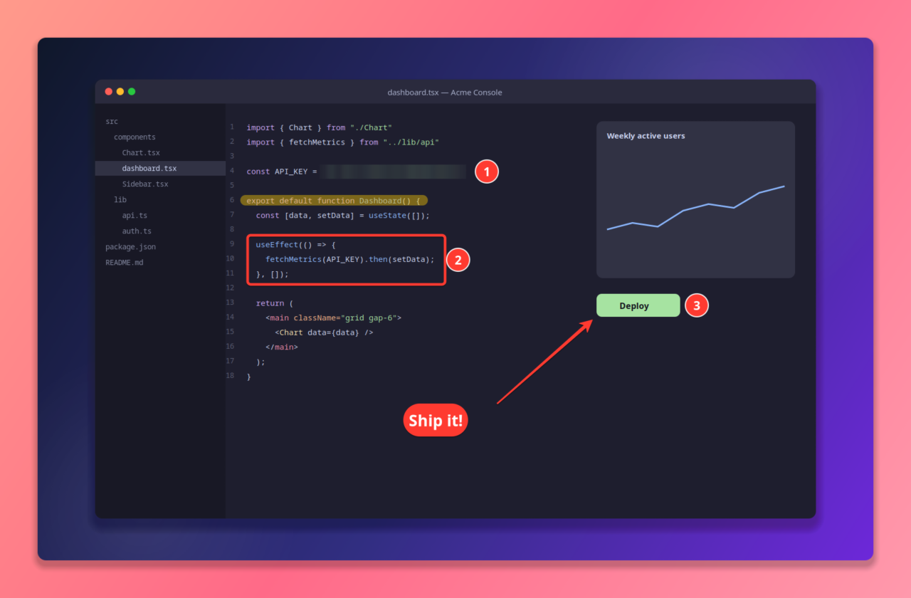
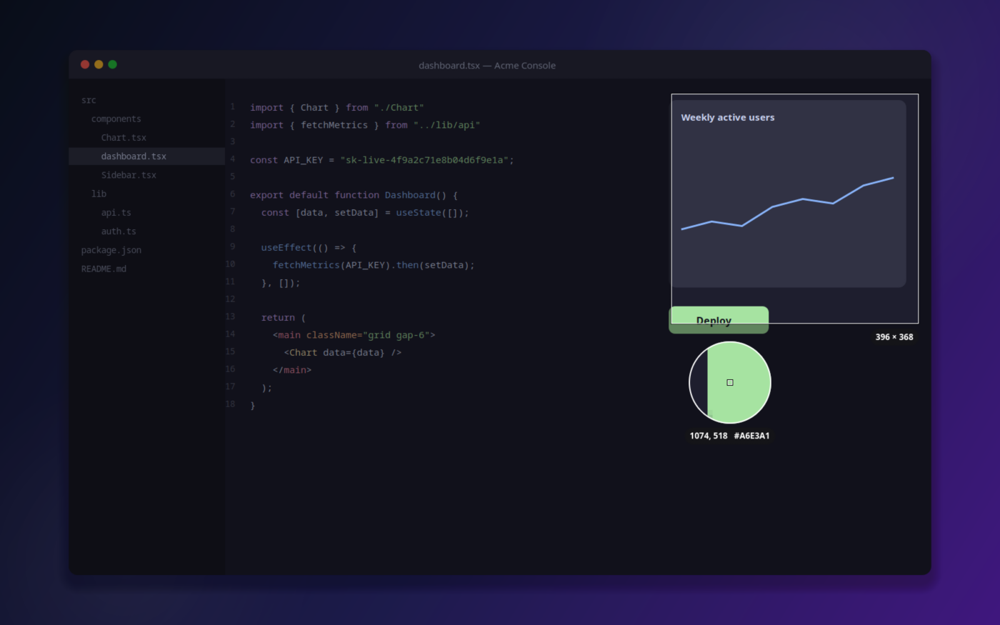
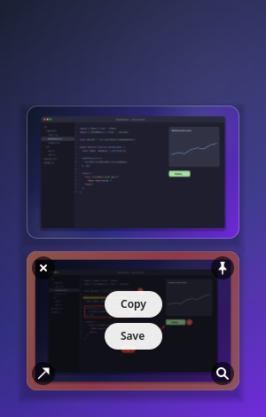
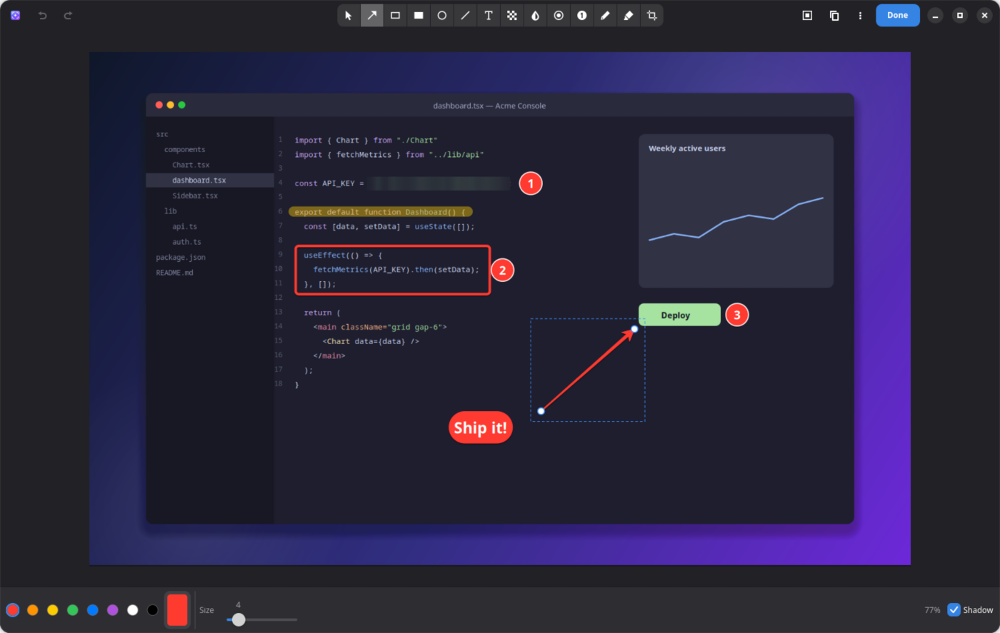
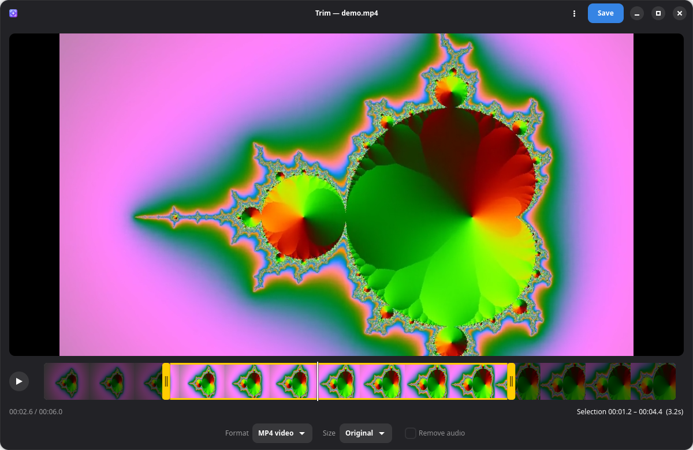
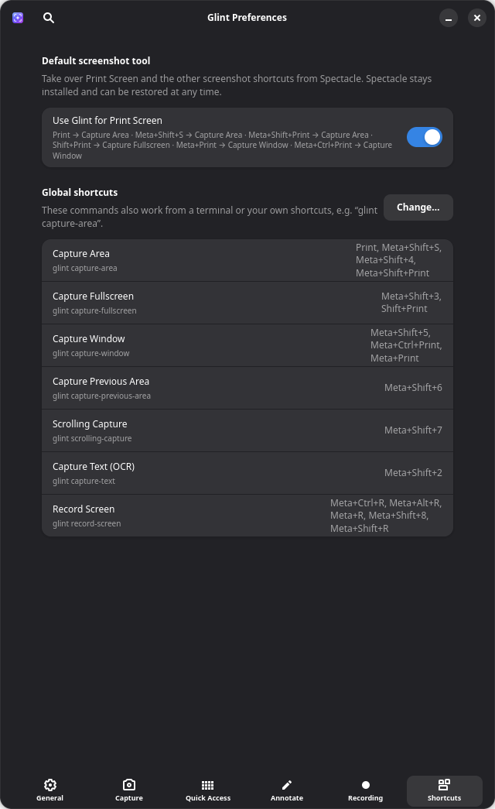

<div align="center">


# Glint

**Capture, annotate and record your screen — beautifully — on Linux.**

A CleanShot X–inspired screenshot and screen‑recording tool for Fedora and KDE Plasma on Wayland.

[](#-installation)
[](#-what-to-expect)
[](#-how-it-works)
[](#-how-it-works)
[](#%EF%B8%8F-development)
[](LICENSE)
[](#-what-to-expect)
[](https://copr.fedorainfracloud.org/coprs/baldybuilds/glint/)
[](https://github.com/baldybuilds/glint/releases/latest)
[](https://github.com/baldybuilds/glint/stargazers)

[Features](#-features) · [Install](#-installation) · [Usage](#-usage) · [Shortcuts](#%EF%B8%8F-keyboard-shortcuts) · [Troubleshooting](#-troubleshooting) · [Development](#%EF%B8%8F-development) · [Contributing](CONTRIBUTING.md)

<br>



</div>

---

## ✨ Features

<table>
<tr>
<td width="50%" valign="top">

### 📸 Capture anything
- **Area, window, fullscreen** or **previous area**
- Frozen-screen overlay with **crosshair**, **magnifier**, pixel **colour picker** and live size label
- **Self-timer** (3 / 5 / 10 s or custom)
- **Scrolling capture** — scroll a page, get one tall image
- **Capture text (OCR)** straight to the clipboard
- Window captures get a **beautiful backdrop** automatically

</td>
<td width="50%" valign="top">

### 🎬 Record your screen
- Record any area, window or display to **MP4** or **GIF**
- Optional **microphone** and **system audio**
- **Click highlighting** — rings wherever you click
- Built-in **trimmer** with filmstrip timeline and frame-accurate export
- Convert to GIF, downscale to 1080p / 720p / 480p, strip audio

</td>
</tr>
<tr>
<td width="50%" valign="top">

### ✏️ Annotate
- Arrow, rectangle, filled rectangle, ellipse, line
- **Text** in six styles, **numbered counters**
- **Blur**, **pixelate** and **spotlight** to hide or highlight
- Pen and highlighter, crop with aspect ratios
- **Backgrounds**: gradients, your wallpaper, padding, rounded corners, shadow

</td>
<td width="50%" valign="top">

### ⚡ Stay in flow
- **Quick Access Overlay**: every capture pops up in a corner — copy, save, annotate, pin or **drag it straight into another app**
- **Pin** screenshots on top of everything
- **Restore recently closed** captures
- Tray menu, global shortcuts, `glint://` URLs and a CLI
- One click to make Glint your **Print Screen** tool

</td>
</tr>
</table>

## 🖼️ Screenshots

<table>
<tr>
<td width="72%"></td>
<td width="28%"></td>
</tr>
<tr>
<td align="center"><sub><b>Area capture</b> — magnifier, colour picker, live size</sub></td>
<td align="center"><sub><b>Quick Access Overlay</b></sub></td>
</tr>
</table>


<p align="center"><sub><b>Annotate</b> — every tool one keypress away</sub></p>

<table>
<tr>
<td width="62%"></td>
<td width="38%"></td>
</tr>
<tr>
<td align="center"><sub><b>Trimmer</b> — export MP4 or GIF</sub></td>
<td align="center"><sub><b>Make Glint your Print Screen tool</b></sub></td>
</tr>
</table>

## 🧭 What to expect

Glint is an **early alpha** built for and tested on **Fedora 45 with KDE Plasma 6 (Wayland)**. It's usable day to day there, but expect rough edges.

| Desktop | Status | Notes |
| --- | :---: | --- |
| **KDE Plasma 6 · Wayland** | ✅ Supported | Everything works; this is where Glint is developed and tested (incl. multi-monitor, NVIDIA). |
| GNOME · Wayland | ⚠️ Partial, untested | Captures go through the XDG portal. Window picking, thumbnail placement and click highlighting need KWin and won't work. |
| Sway / Hyprland | ⚠️ Untested | Uses `grim` for captures; same KWin-only limitations as GNOME. |
| X11 sessions | ❌ Not supported | |

**Good to know**

- 🔐 **Wayland security prompts.** The first recording or scrolling capture asks which screen to share; Glint remembers your choice.
- 🪟 **Window captures** are cut from a full-screen capture, so they don't include transparency or the window's own shadow (Glint adds a nicer backdrop instead).
- 📜 **Scrolling capture** works best with steady, moderate scrolling on static content; animated pages can confuse the stitcher.
- 🧩 **Optional extras** unlock features: `tesseract` (OCR), `ffmpeg` (GIFs, trimming), `gifsicle` (smaller GIFs), `wl-clipboard` (reliable copy).
- 🚧 **Not implemented yet:** cloud upload, hiding desktop icons, Do Not Disturb, keystroke overlay.

## 📦 Installation

### Option 1 — Copr repository *(recommended)*

```sh
sudo dnf copr enable baldybuilds/glint
sudo dnf install glint
```

Updates arrive with your normal `sudo dnf upgrade`. Builds are available for Fedora 44 and 45 on x86_64 and aarch64.

### Option 2 — Download the RPM

Grab **`glint-<version>.noarch.rpm`** from the [latest release](https://github.com/baldybuilds/glint/releases/latest), then:

```sh
sudo dnf install ./glint-*.noarch.rpm
```

It installs system-wide, shows up in the app menu and Discover, and pulls in its dependencies. To upgrade, download the newer RPM and run the same command.

### Option 3 — Build the RPM yourself

```sh
git clone https://github.com/baldybuilds/glint.git
cd glint
packaging/build-rpm.sh
sudo dnf install packaging/rpmbuild/RPMS/noarch/glint-*.noarch.rpm
```

Building needs `rpm-build`, `desktop-file-utils` and `appstream` (`sudo dnf install rpm-build desktop-file-utils appstream`). To upgrade, pull, rebuild and run the same `dnf install` again.

### Option 4 — Per-user install *(no root)*

```sh
git clone https://github.com/baldybuilds/glint.git
cd glint
./install.sh            # installs to ~/.local and checks dependencies
```

Don't mix the two: a `~/.local` install shadows the RPM. Remove it with `./install.sh --uninstall` first.

### Option 5 — Run from the source tree

```sh
./bin/glint --background
```

### Dependencies

Fedora KDE ships almost everything already:

```sh
# Required
sudo dnf install python3-gobject python3-cairo gtk4 libadwaita \
                 gstreamer1-plugins-base gstreamer1-plugins-good pipewire-gstreamer
# H.264 encoder for recordings — either one:
sudo dnf install gstreamer1-plugin-openh264     # Fedora's Cisco OpenH264 repo
sudo dnf install gstreamer1-plugins-ugly        # or x264 from RPM Fusion
# Optional extras
sudo dnf install spectacle ffmpeg-free tesseract gifsicle wl-clipboard
```

> [!NOTE]
> Keep **Spectacle** installed even if Glint replaces it as your Print Screen tool. On Plasma, Glint uses it behind the scenes to grab the screen quickly and silently.

## 🚀 Usage

### First run

1. Launch **Glint** from the app menu (or run `glint --background`). A ✦ icon appears in the system tray.
2. Glint offers to **take over Print Screen** from Spectacle. Say yes and your usual screenshot keys open Glint instead. You can switch back any time.
3. Turn on **Preferences → General → Launch at login**.
4. Press <kbd>Print</kbd> and drag. That's it.

### Capture overlay

| Action | Result |
| --- | --- |
| **Drag** | Select an area (hold <kbd>Shift</kbd> for a square, hold <kbd>Space</kbd> to move it) |
| **Click** | Capture the window under the pointer |
| <kbd>Space</kbd> | Toggle window mode |
| <kbd>F</kbd> | Capture the whole display |
| <kbd>Enter</kbd> | Confirm the selection |
| <kbd>Esc</kbd> / right-click | Cancel |

### Quick Access Overlay

Hover a thumbnail for **Copy**, **Save**, ✕ close, 📌 pin, ✏️ annotate and 🔍 OCR. **Drag** it into any app to drop the file. Double-click to annotate (or to trim, for recordings). Closed by mistake? Use **Restore Recently Closed** from the tray.

### Making Glint your screenshot tool

Glint can swap the desktop's screenshot shortcuts over to itself and give them back later:

- **Preferences → Shortcuts → Use Glint for Print Screen**, or
- `glint set-default` / `glint unset-default`

On KDE, Spectacle's current keys (<kbd>Print</kbd>, <kbd>Shift</kbd>+<kbd>Print</kbd>, <kbd>Meta</kbd>+<kbd>Print</kbd>, <kbd>Meta</kbd>+<kbd>Shift</kbd>+<kbd>S</kbd>, <kbd>Meta</kbd>+<kbd>Shift</kbd>+<kbd>R</kbd>…) move to the matching Glint actions. Your originals, including any you customised, are remembered and restored exactly. GNOME's Shell keybindings are handled the same way (implemented, not yet tested).

> [!IMPORTANT]
> Before uninstalling Glint, run `glint unset-default`. If you forget, reset Spectacle in **System Settings → Shortcuts → Spectacle → Defaults**.

## ⌨️ Keyboard shortcuts

### Global

| Action | Default | After "Use Glint for Print Screen" |
| --- | --- | --- |
| Capture area | <kbd>Meta</kbd>+<kbd>Shift</kbd>+<kbd>4</kbd> | + <kbd>Print</kbd>, <kbd>Meta</kbd>+<kbd>Shift</kbd>+<kbd>S</kbd>, <kbd>Meta</kbd>+<kbd>Shift</kbd>+<kbd>Print</kbd> |
| Capture fullscreen | <kbd>Meta</kbd>+<kbd>Shift</kbd>+<kbd>3</kbd> | + <kbd>Shift</kbd>+<kbd>Print</kbd> |
| Capture window | <kbd>Meta</kbd>+<kbd>Shift</kbd>+<kbd>5</kbd> | + <kbd>Meta</kbd>+<kbd>Print</kbd>, <kbd>Meta</kbd>+<kbd>Ctrl</kbd>+<kbd>Print</kbd> |
| Capture previous area | <kbd>Meta</kbd>+<kbd>Shift</kbd>+<kbd>6</kbd> | |
| Scrolling capture | <kbd>Meta</kbd>+<kbd>Shift</kbd>+<kbd>7</kbd> | |
| Capture text (OCR) | <kbd>Meta</kbd>+<kbd>Shift</kbd>+<kbd>2</kbd> | |
| Record screen (press again to stop) | <kbd>Meta</kbd>+<kbd>Shift</kbd>+<kbd>8</kbd> | + <kbd>Meta</kbd>+<kbd>Shift</kbd>+<kbd>R</kbd> and Spectacle's other record keys |

On Plasma these are registered natively, exactly like Spectacle's, and you can change them under **System Settings → Shortcuts → Glint**. Other desktops get them through the XDG GlobalShortcuts portal.

<details>
<summary><b>Annotation editor shortcuts</b></summary>

| Key | Tool | | Key | Action |
| --- | --- | --- | --- | --- |
| <kbd>V</kbd> | Select / move | | <kbd>Ctrl</kbd>+<kbd>Z</kbd> | Undo |
| <kbd>A</kbd> | Arrow | | <kbd>Ctrl</kbd>+<kbd>Shift</kbd>+<kbd>Z</kbd> | Redo |
| <kbd>R</kbd> | Rectangle | | <kbd>Ctrl</kbd>+<kbd>C</kbd> | Copy image |
| <kbd>Shift</kbd>+<kbd>R</kbd> | Filled rectangle | | <kbd>Ctrl</kbd>+<kbd>S</kbd> | Save to Screenshots |
| <kbd>O</kbd> | Ellipse | | <kbd>Ctrl</kbd>+<kbd>Shift</kbd>+<kbd>S</kbd> | Save as… |
| <kbd>L</kbd> | Line | | <kbd>Ctrl</kbd>+<kbd>Enter</kbd> | Done (save & close) |
| <kbd>T</kbd> | Text | | <kbd>[</kbd> / <kbd>]</kbd> | Thinner / thicker |
| <kbd>P</kbd> | Pixelate | | <kbd>Delete</kbd> | Delete selection |
| <kbd>B</kbd> | Blur | | Arrow keys | Nudge (<kbd>Shift</kbd> = 10 px) |
| <kbd>S</kbd> | Spotlight | | <kbd>Shift</kbd> while drawing | Snap angles / squares |
| <kbd>N</kbd> | Counter | | <kbd>Ctrl</kbd>+scroll | Zoom |
| <kbd>D</kbd> / <kbd>H</kbd> | Pen / highlighter | | <kbd>Ctrl</kbd>+<kbd>0</kbd> | Fit to window |
| <kbd>C</kbd> | Crop | | <kbd>Esc</kbd> | Deselect / close |

</details>

<details>
<summary><b>Pinned screenshots &amp; trimmer</b></summary>

**Pinned screenshots:** drag to move · scroll to zoom · <kbd>Ctrl</kbd>+scroll for opacity · double-click to annotate · right-click for options · <kbd>Esc</kbd> to close.

**Trimmer:** <kbd>Space</kbd> play/pause · <kbd>I</kbd> / <kbd>O</kbd> set in/out at the playhead · <kbd>←</kbd>/<kbd>→</kbd> step a frame (<kbd>Shift</kbd> = 10 frames) · <kbd>Home</kbd>/<kbd>End</kbd> jump to in/out · <kbd>Ctrl</kbd>+<kbd>S</kbd> save.

</details>

## 🧰 Command line &amp; URL scheme

Every action can be scripted. Commands are sent to the running instance (it starts if needed):

```sh
glint capture-area | capture-window | capture-fullscreen | capture-previous-area
glint self-timer seconds=5 | scrolling-capture | capture-text
glint record-screen format=gif          # run again to stop
glint open-annotate image.png | pin image.png | open-from-clipboard
glint trim-video recording.mp4
glint set-default | unset-default       # take over / give back Print Screen
glint restore-recently-closed | preferences | quit
glint --help
```

The same commands work as URLs, e.g. `xdg-open 'glint://pin?filepath=/home/me/shot.png'`.

## ⚙️ Configuration

Everything is in **Preferences** (tray → Preferences…). Under the hood:

| What | Where |
| --- | --- |
| Settings | `~/.config/glint/config.json` |
| Screenshots | `~/Pictures/Screenshots` *(configurable)* |
| Recordings | `~/Videos/Screencasts` *(configurable)* |
| Unsaved captures | `~/.cache/glint/captures` |

File names use a template. The default is `Glint {date} at {time}`, and the available tokens are `{date} {time} {year} {month} {day} {hour} {minute} {second} {type} {width} {height} {counter}`.

## 🔬 How it works

<details>
<summary>Wayland doesn't let apps read the screen or place their own windows. Here's how Glint gets around that.</summary>

<br>

| Need | Approach |
| --- | --- |
| Read screen pixels | Spectacle in background mode (KWin's privileged ScreenShot2) → XDG Screenshot portal → `grim` |
| Window geometry, cursor, work area | Short-lived KWin scripts that report back over D-Bus |
| Keep-above & positioning of Glint's windows | A KWin rules script keyed on window titles like `glint:qa:<x>:<y>` |
| Video frames | XDG ScreenCast portal (restore token persisted) → `pipewiresrc` → GStreamer |
| Tray icon | Hand-written StatusNotifierItem + DBusMenu over Gio |
| Global shortcuts | KGlobalAccel via the `.desktop` file on Plasma; XDG GlobalShortcuts portal elsewhere |
| Click highlighting | KWin's built-in *Mouse Click Animation* effect, configured only while recording and restored afterwards |
| Scrolling capture | Row-hash overlap matching with sticky header/footer detection (pure Python) |
| Trimming | GTK's GStreamer playback for preview; ffmpeg input-seek + re-encode for frame-accurate cuts |
| Clipboard | `wl-copy` (works without keyboard focus), GDK fallback |

</details>

## 🩺 Troubleshooting

<details>
<summary><b>Print Screen still opens Spectacle</b></summary>

Run `glint set-default` or turn on **Preferences → Shortcuts → Use Glint for Print Screen**.
</details>

<details>
<summary><b>Glint's shortcuts don't do anything</b></summary>

Check **System Settings → Shortcuts → Glint**. If Glint isn't listed, run `kbuildsycoca6` (or log out and back in) so Plasma rescans installed apps. Glint must be running in the tray for shortcuts to respond instantly.
</details>

<details>
<summary><b>I uninstalled Glint and Print Screen does nothing</b></summary>

Go to **System Settings → Shortcuts → Spectacle** and click **Defaults**. Next time, run `glint unset-default` before uninstalling.
</details>

<details>
<summary><b>Thumbnails or pinned images appear in the wrong place / aren't on top</b></summary>

Placement relies on KWin scripting, which only exists on KDE Plasma. On other desktops the window manager decides where these windows go.
</details>

<details>
<summary><b>"Text recognition needs Tesseract" / GIF export fails</b></summary>

`sudo dnf install tesseract` for OCR and `sudo dnf install ffmpeg-free gifsicle` for GIFs and trimming.
</details>

<details>
<summary><b>Recording asks which screen to share every time</b></summary>

Pick **Allow restoring** (or similar) in the KDE dialog. To reset the remembered choice, use **Preferences → Recording → Forget shared screens**.
</details>

<details>
<summary><b>Seeing what's going on</b></summary>

```sh
glint quit
GLINT_DEBUG=1 glint --background
```
</details>

## 🛠️ Development

```sh
/usr/bin/python3 -m unittest discover -s tests -t .              # unit tests (no display needed)
GLINT_DEBUG=1 GLINT_NO_SHORTCUTS=1 ./bin/glint --background       # run from the tree
packaging/build-rpm.sh                                            # build the RPM (also runs the tests)
git tag v0.3.0 && git push --tags                                 # release: CI builds and publishes the RPMs
```

Use the **system** interpreter (`/usr/bin/python3`): PyGObject, GTK and GStreamer bindings come from Fedora packages. `GLINT_NO_SHORTCUTS=1` skips shortcut registration and the first-run prompt, which is useful while hacking.

<details>
<summary><b>Project layout</b></summary>

```
glint/
├── app.py            commands, capture workflows, first-run prompt
├── overlay.py        area / window selection overlay with magnifier
├── capture.py        Spectacle / portal / grim backends, multi-monitor model
├── quickaccess.py    floating thumbnails (Quick Access Overlay)
├── annotate/         editor window, shape model, backgrounds
├── pin.py            pinned screenshots
├── scrolling.py      scrolling capture session  ·  stitcher.py  frame stitching
├── recorder.py       MP4/GIF recording  ·  screencast.py  ScreenCast portal
├── trimmer.py        video trimmer  ·  clicks.py  click highlighting
├── takeover.py       "use Glint for Print Screen" (KDE + GNOME)
├── tray.py           StatusNotifierItem + DBusMenu
├── kwin.py           KWin scripting bridge  ·  portal.py  XDG portal client
└── prefs.py          preferences
data/                 desktop entry, AppStream metadata, icons, CSS
packaging/            RPM spec and build script
tests/                unit tests
```
</details>

## 🗺️ Roadmap

- [x] GitHub Releases with ready-to-install RPMs
- [x] Copr repository for one-line installs and automatic updates
- [ ] Verified GNOME support
- [ ] Keystroke overlay for recordings
- [ ] Cloud / custom-server upload
- [ ] Flatpak (needs portal-only capture paths)

Contributions and [bug reports](https://github.com/baldybuilds/glint/issues) are very welcome. See **[CONTRIBUTING.md](CONTRIBUTING.md)** for how to report bugs, set up a dev environment and open a pull request.

## 👥 Contributors

<table>
<tr>
<td align="center">
<a href="https://github.com/baldybuilds"><br><sub><b>baldybuilds</b></sub></a><br>
<sub>Creator &amp; maintainer</sub>
</td>
</tr>
</table>

Want to see your face here? Read the [contributing guide](CONTRIBUTING.md) and [open a pull request](https://github.com/baldybuilds/glint/pulls).

## ⚖️ Disclaimer

Glint is an independent open-source project. It is **not affiliated with, endorsed by, or connected to** MakeTheWeb or CleanShot X. "CleanShot" is a trademark of its respective owner and is used here only to describe the kind of tool Glint is. Glint contains no code, artwork or other assets from CleanShot X.

## 📄 License

[MIT](LICENSE) © 2026 [baldybuilds](https://github.com/baldybuilds)
